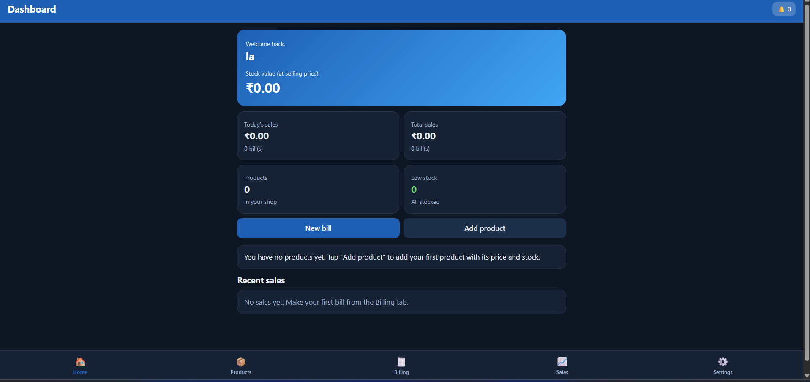

Smart Inventory App

A web-based application for managing shop inventory, billing, and sales.

Features

User Registration and Login
Product Management
Stock Updates and Low-Stock Alerts
Billing and Automatic Stock Reduction
Sales History and Dashboard
Shop Settings
Technologies Used HTML, CSS, JavaScript, Local Storage

How to Run

Download the repository.
Open Smart Inventory.html in a web browser.
Register and start using the application.
Project Type College Mini Project

Our site is live at https://lalithkhalap.github.io/smart-inventory

